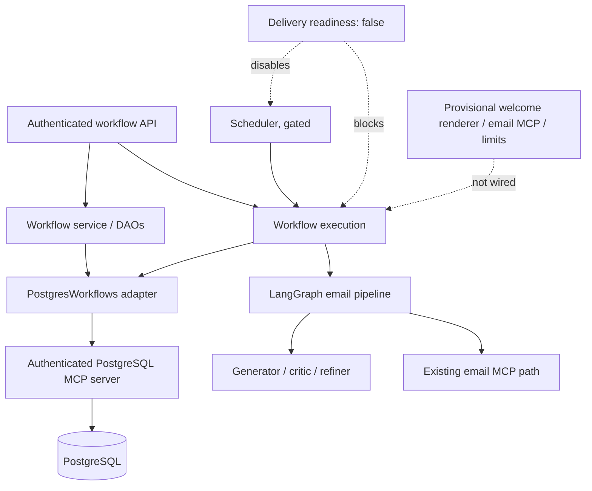

# Architecture

## Stack and layers

Python 3.11+, FastAPI/Pydantic, LangGraph/LangChain, APScheduler and MCP. `main.py` owns the FastAPI lifespan and scheduler; `app/api/workflows.py` injects `WorkflowService` and DAOs. The app mounts its already-prefixed router at `/api/api/workflows`. `app/services/postgres_workflows.py:PostgresWorkflows` uses `app/mcp/postgres_client.py:PostgresMCPClient` for data access rather than a local pool. The LangGraph generator, critic, refiner, guardrails, and old email MCP path remain present but are gated by delivery readiness.

`delivery_readiness.is_delivery_ready()` currently always returns false. Startup calls `initialize_scheduler`, which declines to start; triggers return 503 before claiming. `/health` is liveness; `/health/ready` probes PostgreSQL MCP and requires delivery readiness, so currently returns 503. Starting the app does not initialize the separate legacy MCP registry.

The graph starts at the generator without an input-validation node. `run_email_pipeline` does not initialize `input_guardrail_passed`, so the generator skips generation if this gate is later enabled. See [workflow pipeline](components/workflow-pipeline.md).

New template retrieval, rendering, delivery limits and email MCP components are local prototypes; the existing execution path still invokes the graph, not these components. Their external contracts and integration remain unverified.

Sources: main.py, pyproject.toml, app/api/workflows.py, app/core/scheduler.py, app/services/delivery_readiness.py, app/services/postgres_workflows.py, app/services/workflow_execution.py, app/services/email/welcome_renderer.py, app/services/email/delivery_limits.py, app/mcp/email_client.py, app/mcp/postgres_client.py, app/graph/workflow.py, app/graph/executor.py, app/agents/generator/node.py
Verified: 2026-11-10
